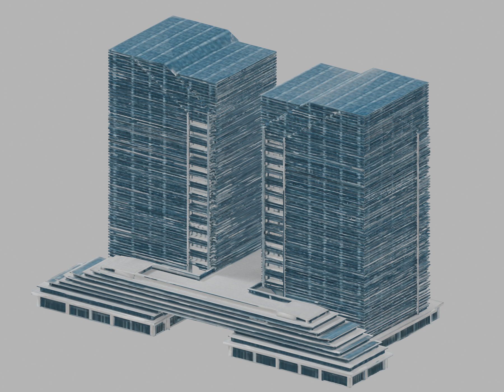

# 双塔幕墙建筑 · 源网格约束重拓扑

本版本直接处理用户提供的 `Meshy_AI_Twin_Glass_Towers_1101141931_texture.glb`，以原网格表面为约束简化拓扑，保留双塔轮廓、折面屋顶、裙房退台和源模型的表面细节。幕墙外观沿用原始 UV 映射和 PBR 贴图，不用程序化窗格替代，不推断或新增楼层数。

源文件的三张 2K PBR 贴图无损复用并内嵌于 GLB，包含原始颜色、金属度/粗糙度及法线信息；法线贴图保留原始图片字节。几何简化会改变拓扑及顶点法线，因此保真度应结合[原模型对照与处理报告](../../public/models/twin-glass-towers/comparison.html)判断。默认简化比例为 `0.30`，目标约 130 万三角面；最终面数、文件体积、材质和处理步骤以 [`model-info.json`](../../public/models/twin-glass-towers/model-info.json) 为准。

原始 172.08 MB 的 GLB 只作为本机输入，不提交到仓库。可编辑 `.blend` 保存重拓扑结果、8 个建筑区域分组和打包贴图。尺寸采用统一缩放后的参考比例，不代表实测建筑尺寸。



## 文件

| 文件 | 用途 |
| --- | --- |
| [`twin-glass-towers.glb`](../../public/models/twin-glass-towers/twin-glass-towers.glb) | Three.js 可直接加载的模型，原始 PBR 图片内嵌 |
| [`twin-glass-towers.blend`](./twin-glass-towers.blend) | Blender 4.5 LTS 可编辑重拓扑结果，贴图已打包 |
| [`twin-glass-towers.threeauto`](../../public/models/twin-glass-towers/twin-glass-towers.threeauto) | 包含模型、相机、灯光与中性反射环境的 ThreeAuto Creator 项目 |
| [`index.html`](../../public/models/twin-glass-towers/index.html) | 已构建的独立 Three.js 演示，支持旋转、缩放、平移和线框 |
| [`comparison.html`](../../public/models/twin-glass-towers/comparison.html) | 原模型与处理结果的对照和保真度报告 |
| [`model-info.json`](../../public/models/twin-glass-towers/model-info.json) | 实际统计、贴图保留信息和处理配方 |
| [`rebuild.py`](./rebuild.py) | 以原始 GLB 为输入的 Blender 重拓扑脚本 |
| [`finalize.mjs`](./finalize.mjs) | 几何量化与交付 GLB 整理，保留 UV 和原始图片 |
| [`build.mjs`](./build.mjs) | 构建静态演示、中性 HDR 与 Creator 项目包 |

## 直接预览

在仓库根目录执行：

```powershell
python -m http.server 9713 --directory public
```

打开 <http://localhost:9713/models/twin-glass-towers/>，通过「查看原模型对照与处理报告」检查处理结果。演示已包含 Three.js，不依赖 CDN；资源地址全部相对当前目录，也可托管在站点子路径下。浏览器需要通过 HTTP 加载模型，不能直接双击 HTML。

## 导入 Three.js

模型导出为 **Y 向上、底面 Y=0**，源网格统一放大 100 倍，1 个导出单位按 1 米解释。包围尺寸约 **190.02 × 126.53 × 104.22**（X/Y/Z），页面与项目相机都从实际 GLB 包围盒计算，不需要再旋转模型。

```js
import * as THREE from 'three';
import { GLTFLoader } from 'three/addons/loaders/GLTFLoader.js';
import { HDRLoader } from 'three/addons/loaders/HDRLoader.js';

const base = `${import.meta.env.BASE_URL}models/twin-glass-towers/`;
const gltf = await new GLTFLoader().loadAsync(`${base}twin-glass-towers.glb`);
scene.add(gltf.scene);
// 沿用 GLTFLoader 还原的材质、颜色空间、PBR 贴图和法线。

const hdr = await new HDRLoader().loadAsync(`${base}studio.hdr`);
const pmrem = new THREE.PMREMGenerator(renderer);
const environment = pmrem.fromEquirectangular(hdr);
scene.environment = environment.texture;
scene.environmentIntensity = 1;
hdr.dispose();
pmrem.dispose();
// 场景卸载时还需释放 environment、模型几何体、材质及其贴图。
```

示例使用 Three.js 0.185.1 的 `HDRLoader`；Three.js 0.164 的项目可改用 `RGBELoader`。GLB 可由常规 `GLTFLoader` 加载，无 Draco/Meshopt 解码器和外部贴图请求。16 位几何量化使用标准 `KHR_mesh_quantization` 扩展，UV 与图片不参与有损压缩。中性环境、白色灯光和曝光 `1` 用于显示原始材质，避免强光冲淡贴图细节。

完整相机取景、窗口缩放、失败清理和场景卸载逻辑见 [`viewer.js`](./viewer.js) 与 [`framing.js`](./framing.js)。释放材质时也要释放其颜色、法线及金属度/粗糙度贴图；共享贴图只释放一次。

## 导入 ThreeAuto Creator

在编辑器选择「项目 → 打开项目包」，打开 `public/models/twin-glass-towers/twin-glass-towers.threeauto`。项目包包含与演示一致的 GLB、原始内嵌贴图、中性环境、相机和灯光，可继续编辑并导出独立网页。也可仅使用「导入 GLB 模型」，自行设置场景环境。

## 重新生成

需要 Blender 4.5 LTS、Node.js **20 或以上**，以及用户提供的原始 GLB。本仓库不包含原始 GLB；仅有仓库文件时，可预览和使用交付模型，也可编辑已打包的 `.blend`，重新执行源网格处理则必须提供原始输入。

在仓库根目录执行，使用实际的 Blender 和源文件路径：

```powershell
# 先确认当前终端使用 Node.js 20 或以上。
node --version
npm ci --prefix models/twin-glass-towers
blender --background --factory-startup --python models/twin-glass-towers/rebuild.py -- --source "D:\path\Meshy_AI_Twin_Glass_Towers_1101141931_texture.glb" --ratio 0.30 --render
node models/twin-glass-towers/finalize.mjs
npm run build --prefix models/twin-glass-towers
npm test --prefix models/twin-glass-towers
```

`--ratio` 默认值为 `0.30`，可选 `0.25` 获得更轻的模型。调整它会改变拓扑和文件体积，应重新检查对照结果。Blender 保持 Z 向上，glTF 导出负责转换为 Y 向上并统一缩放、落地；后处理只对几何执行量化，保留 UV 和原始图片。先生成交付 GLB 和统计，再构建演示与项目包，保证下载文件、页面统计和 Creator 项目一致。

构建工具独立于根目录音频应用，依赖由本目录 `package-lock.json` 锁定。`public/models/twin-glass-towers/` 可直接静态托管；Three.js 的完整许可随演示保存在 `THREE-LICENSE.txt`。
